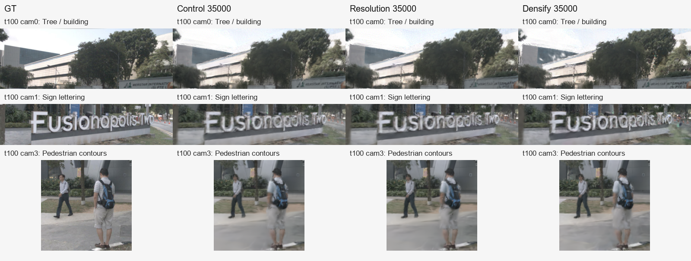
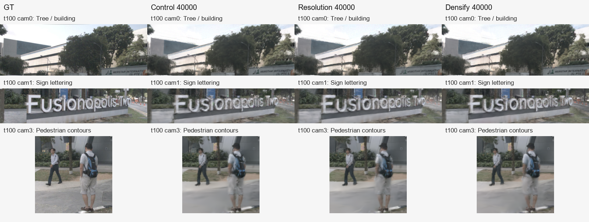

# EXP-001～003：晚期续训结果

三组均从同一 **29,381 步 baseline** 独立恢复至 **40,000 步**，Adam 优化器重建，学习率仍按全局步数调度。这一轮验证的是晚期续训，不能否定从头训练采用这些策略的效果。

结论：续训有有限收益；单独切换高清输入退化；背景增密仅部分感知指标改善，成本更高，整体模糊仍存在。已评估检查点中，对照 35,000 步的 PSNR/SSIM 最好；背景增密 40,000 步的 LPIPS 最低。

## 实验条件

nuScenes scene-0061，191 时刻、六相机；训练 1,032 张，留出 114 张；seed=0。数据划分和评估掩码固定。运行源码：`4d391e7721aaec04a0f50b08416dd7f8e955913f`。

| 实验 | 主要变化 | 配置 | 报告 |
|---|---|---|---|
| EXP-001 | 原配置续训 | [配置](../../configs/experiments/exp-001-control.yaml) | [报告](exp-001-control.md) |
| EXP-002 | 加载尺寸 533×300 → 800×450 | [配置](../../configs/experiments/exp-002-resolution.yaml) | [报告](exp-002-resolution.md) |
| EXP-003 | 背景停止增密步数 20,000 → 35,000 | [配置](../../configs/experiments/exp-003-bg-densify.yaml) | [报告](exp-003-bg-densify.md) |

## 相同分辨率、相同步数的留出集比较

全部使用约 533×300 的相同 GT 和掩码计算。高清组在该尺寸重新渲染，没有从视频或缩放截图计算指标。

| 实验 | 步数 | PSNR ↑ | SSIM ↑ | LPIPS ↓ |
|---|---:|---:|---:|---:|
| 原配置续训 | 35,000 | **24.397171** | **0.773258** | **0.200128** |
| 高清输入 | 35,000 | 24.170671 | 0.768853 | 0.205527 |
| 背景增密 | 35,000 | 23.407332 | 0.752195 | 0.214744 |
| 原配置续训 | 40,000 | **24.358997** | 0.762057 | 0.195538 |
| 高清输入 | 40,000 | 24.186669 | 0.761543 | 0.197761 |
| 背景增密 | 40,000 | 24.283904 | **0.763419** | **0.188899** |

历史 baseline 为 24.079343 / 0.760701 / 0.220589。对照最终相对它 PSNR +0.2797 dB、LPIPS −0.02505，但步数和恢复过程不同，不能将其全部归因于某项算法。

增密组在 35,000 步显著退化，40,000 步恢复并改善 LPIPS；相对同为 40,000 步的对照，其总高斯数约增加 77.7%，模型文件约增加 41.3%，峰值 allocated 显存约增加 39.3%。目前不建议默认替换对照。

## 同帧结果与短视频

固定第 100 时刻，分别比较建筑/树冠、招牌和行人；图像是共同尺寸的原始像素裁切，没有缩放或锐化。文字、树叶和人体轮廓仍有明显细节损失。

下列均为相同六视角布局、19 帧、2 FPS 的留出集视频，模型均为 40,000 步。

| GT | EXP-001 | EXP-002（共同尺寸） | EXP-003 |
|---|---|---|---|
| [播放](baseline-001/videos/scene0061_test_gt.mp4) | [播放](exp-001-control/test_rgb_step40000.mp4) | [播放](exp-002-resolution/test_rgb_step40000.mp4) | [播放](exp-003-bg-densify/test_rgb_step40000.mp4) |

## 产物与执行说明

- 三组的 35,000 / 40,000 步模型位置及 SHA256 见 [模型索引](model_index_20261108.json)。模型和完整材料在 `artifacts/20261107/`。
- 各实验分支：`codex/exp-001-control`、`codex/exp-002-resolution`、`codex/exp-003-bg-densify`。
- 高清组在保存模型后，原生全场景导出因 CPU 内存不足被终止；已用同一模型流式补齐。恢复结果的原留出集全部 11 项指标与原评估完全一致。
- baseline 在新环境重新评估，全部 11 项留出指标与历史归档完全一致。完整校验、日志及逐帧输出仅本地归档，未纳入本精简提交。
- 全场景指标包含训练和留出图像；区域指标依赖既有掩码。单场景、单种子结果不代表多场景稳定收益。

下一轮 EXP-004/005 改为从头训练，以检验初始表示、早期增密和完整学习率调度是否影响高清策略的效果。
