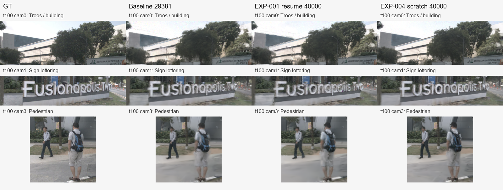
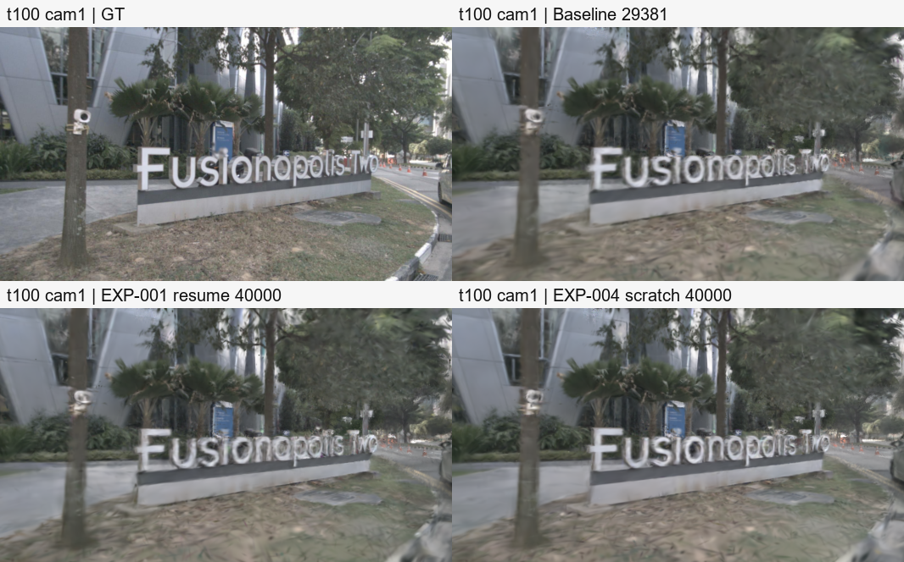

# EXP-004：原配置从头训练

状态：训练、评估、回传校验已完成，并复核了 t50/t100/t150 的同帧图像。部分背景纹理较 baseline 改善，但文字及人体仍有模糊；全留出集 PSNR/SSIM 下降，不能认定从头训练整体优于续训。

- 更新时间：2026-11-08T13:50:58+08:00。
- 分支：`codex/exp-004-from-scratch-control`；实际运行源码：`51bfdac3e202d6373c42705e0a7e01f36ac11f5f`。
- 初始化：从数据开始，`resume_from=None`，目标 40,000 步；最终模型步号：40000。
- 主训练进程退出码：0；耗时 5.078 小时，不含独立流式评估。
- 已回传并校验 331 个清单文件；模型、完整日志和原始输出位于 `E:\ai_learning\omnire_opti\artifacts\20261108-fresh\exp-004-from-scratch-control`。
- [配置](../../configs/experiments/exp-004-from-scratch-control.yaml)

## 留出集指标

| 指标 | 共同约 533×300 留出集 |
|---|---:|
| psnr | 23.082887080677768 |
| ssim | 0.6855715518457848 |
| lpips | 0.1895934154459259 |
| human_ssim | 0.5532890345858431 |
| vehicle_ssim | 0.5551861988549883 |

原始指标及短视频见本实验同名目录。原生与共同分辨率结果分开保存；全场景指标包含训练与留出图像。以 EXP-004 和 EXP-005 同步数、同评估尺寸的结果作方法对照。

## 与 baseline、续训对照比较

三组均在相同约 533×300、相同 114 张留出图像上评估。baseline 为 29,381 步历史模型，EXP-001 为该模型续训至 40,000 步，EXP-004 为从头训练至 40,000 步；两条训练轨迹不同。

| 模型 | PSNR ↑ | SSIM ↑ | LPIPS ↓ | 人体 SSIM ↑ | 车辆 SSIM ↑ |
|---|---:|---:|---:|---:|---:|
| baseline 29,381 | 24.079343 | 0.760701 | 0.220589 | 0.658651 | 0.718535 |
| EXP-001 续训 40,000 | 24.358997 | 0.762057 | 0.195538 | 0.665622 | 0.717035 |
| EXP-004 从头 40,000 | 23.082887 | 0.685572 | 0.189593 | 0.553289 | 0.555186 |

EXP-004 相对 EXP-001：PSNR −1.2761 dB，SSIM −0.07649，LPIPS −0.00594（约改善 3.0%）。感知距离略有改善，但像素、结构及动态区域指标明显退化，目前不建议用 EXP-004 替代 EXP-001。这里只描述观测结果，不将差异归因为学习率单一因素。

## 相同帧可视化

列顺序：GT → baseline → EXP-001 续训 → EXP-004 从头训练。所有裁切均直接使用原始 533×300 PNG，没有缩放、锐化或颜色调整。t50/t100/t150 均属于留出时刻；对这三个时刻的全部六相机核对，EXP-001、EXP-004 与 baseline 的 GT 共 36 对逐像素相同。

- 树木与建筑：EXP-004 的部分叶片、建筑边缘较 baseline 清楚，但与 EXP-001 的差别有限；细枝纹理仍有涂抹。
- 招牌：大字轮廓保留，细字边缘和后半段文字仍模糊，没有恢复到 GT 的锐利程度。
- 行人：背包及人体轮廓仍有破碎、拖影，地面也有明显平滑；局部样例不能替代全留出集的人体/车辆指标。

以下每张图均为左上 GT、右上 baseline、左下 EXP-001、右下 EXP-004：

[t50 对比](comparisons/exp004/full_t050_cam1.png) · [t150 对比](comparisons/exp004/full_t150_cam1.png) · [EXP-004 留出视频](exp-004-from-scratch-control/test_rgb_step40000.mp4)

## 判断范围

单场景、单种子；当前仅人工查看三个固定留出时刻，尚未对整个视频逐帧复核。EXP-004/005 的从头训练配对结果仍需待 EXP-005 完成后，在相同步数及共同尺寸下比较，不能凭本组推断高清策略是否有效。
